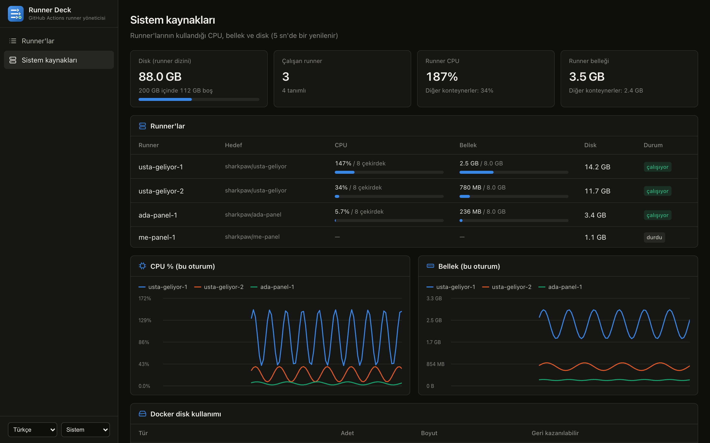
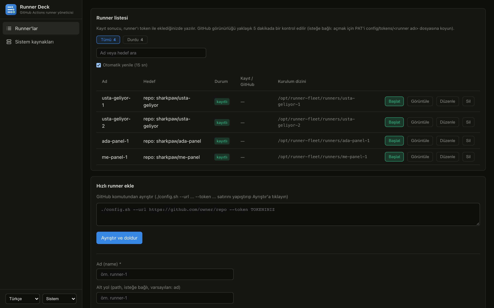
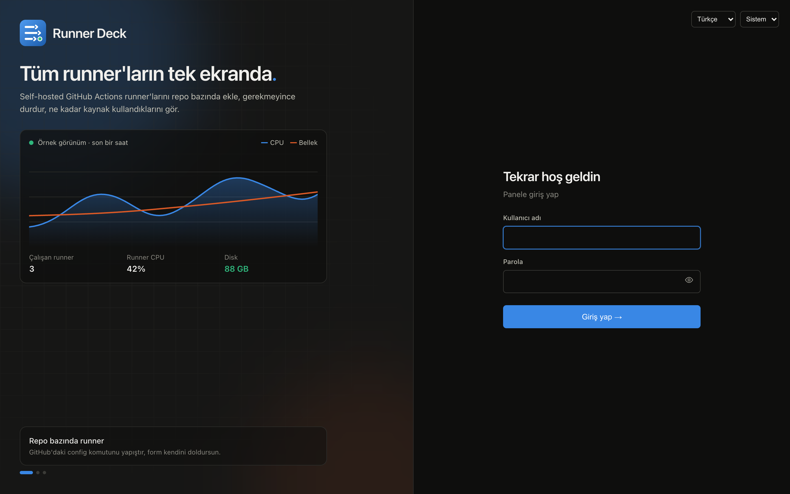

  

<h1 align="center">Runner Deck</h1>

  Self-hosted GitHub Actions runner'larını tek ekrandan ekle, durdur ve kaynak kullanımını izle.

  <a href="README.md">English</a> · <b>Türkçe</b>

## Neden?

Her repo için ayrı compose dosyası tutmak yerine runner'larını tek arayüzden yönetirsin. Bir repoya 1 runner, diğerine 3 runner vermek birkaç tıklama sürer. Hangisinin ne kadar CPU, bellek ve disk tükettiğini de aynı yerden görürsün.

- **Repo bazında runner:** GitHub'ın verdiği `./config.sh` satırını yapıştır, form kendini doldursun.
- **Sistem kaynakları:** runner başına CPU, bellek ve disk, oturum grafikleri ve Docker disk kullanımı.
- **Kaynak sınırları:** varsayılan 4 CPU / 8 GB, panelden genel ve runner başına değişir; sınıra takılınca uyarı görünür.
- **İstatistik ve geçmiş:** iş sayısı, başarı oranı, ortalama süre; 30 güne kadar CPU ve bellek geçmişi.
- **Temizlik:** runner work dizini, eski derleme önbelleği ve kullanılmayan imajlar panelden temizlenir.
- **Kayıtlar:** başlama, durma, iş sonucu, bellek taşması ve hatalar saatiyle kalıcı olarak tutulur.
- **Her runner kendi konteynerinde:** work dizinleri ayrı, checkout'lar birbirini ezmez.
- **Veritabanı yok:** tüm yapılandırma tek YAML dosyasında.
- **Yedi dil:** Türkçe, English, 中文, Français, Deutsch, 한국어, 日本語.
- **Giriş sayfası:** parolalı oturum. Scriptler için Basic Auth da çalışır.
- **Açık ve koyu tema**, telefonda da çalışır.

## Coolify'a kurulum

1. Coolify'da bu repodan **Docker Compose** kaynağı oluştur. Compose yolu varsayılan `docker-compose.yml` kalsın.
2. Domain otomatik gelmez: `runner-manager` servisine domaini `https://alanadin.com:8080` biçiminde yazıp deploy et.
3. Giriş parolası Coolify'ın ürettiği `SERVICE_PASSWORD_RUNNERDECK` değişkenindedir, kullanıcı adı `admin`.
4. Arayüzden **Hızlı runner ekle** ile ilk runner'ını ekle.

Başka bir ortama kurulum için [Kullanım Kılavuzu](docs/guide.md) ve [örnekler](examples/deploy/) klasörüne bak.

## MCP

`https://yöneticin/mcp` adresini Claude veya başka bir MCP istemcisine ekle. OAuth ile giriş yapar; Oturumlar sayfasından görüp sonlandırabilirsin.

## Masaüstü uygulaması

Gerçek Mac gerektiren derlemeler için [masaüstü uygulaması](desktop/README.md) yöneticiyi kendi bilgisayarında, runner'ları da Docker olmadan normal süreç olarak çalıştırır. Aynı pencereden sunucularının panelleri de açılır. [Apple Silicon](https://github.com/sharkpaw/runner-deck/releases/download/desktop-latest/RunnerDeck-macos-arm64.dmg) veya [Intel](https://github.com/sharkpaw/runner-deck/releases/download/desktop-latest/RunnerDeck-macos-x64.dmg) için indir.

## Güvenlik

- **Yalnızca private repo bağla.** Public repoda pull request açabilen herkes bu makinede kod çalıştırabilir.
- **Docker soketi host'ta root demektir.** Yönetici arayüzüne giren runner ekleyip kod çalıştırabilir, bu yüzden parolayı güçlü tut.
- Ayrıntılar: [SECURITY.md](SECURITY.md).

Ekran görüntülerindeki veriler örnektir.

## Teşekkürler

Bu projenin başlangıç noktası olan [soulteary/runner-fleet](https://github.com/soulteary/runner-fleet) projesine teşekkürler.
